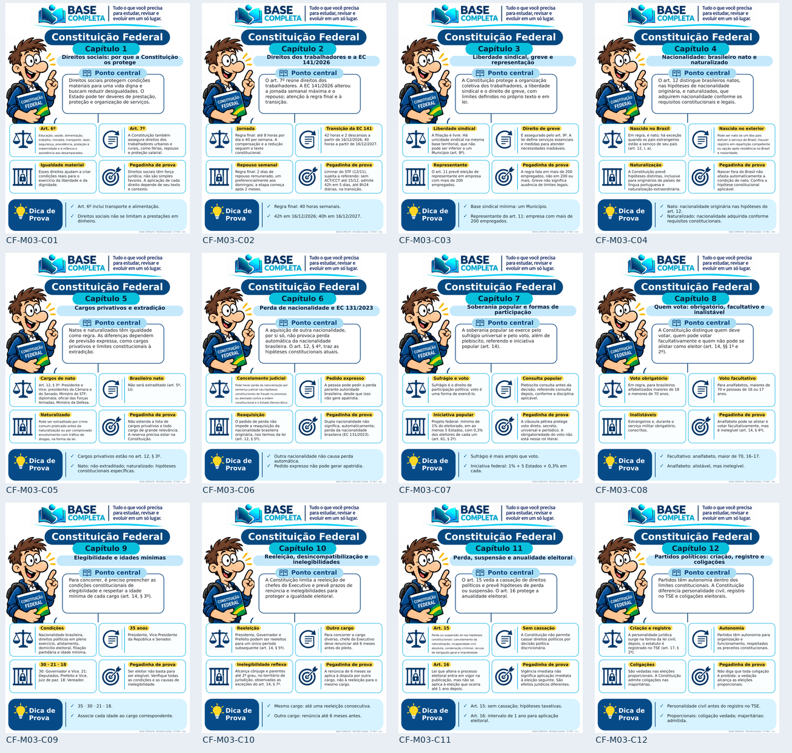

# Relatório — Revisão Guiada de Direito Constitucional, M3

**Data:** 18/11/2026
**Escopo:** exclusivamente módulo M3, “Direitos sociais, nacionalidade e direitos políticos”.

## Mapeamento e artes

Foram identificados 12 capítulos na Revisão Guiada real do M3. Foram produzidas 12 artes em PNG de 1229 × 1536 px, com os títulos originais e numeração de capítulo correspondente.

As imagens reutilizam recortes da logomarca, do personagem e dos ícones visíveis nas referências anexadas. O layout foi montado por template SVG programático e conteúdo separado em JSON; não foram criadas ilustrações novas por IA. A Central recebe WebP otimizados, com carregamento `lazy` e dimensões declaradas.

## Revisão jurídica

Os resumos foram conferidos com o conteúdo vigente da Constituição Federal. O capítulo 2 foi revisado para destacar a EC 141, de 16/10/2026: jornada final de 40 horas semanais, etapa de 42 horas após dois meses da publicação (16/12/2026) e repouso semanal de dois dias na forma e transição previstas pela emenda. A arte indica que a transição ainda não havia começado em 18/11/2026, data local da solicitação.

A legislação original da Revisão Guiada não foi editada; a atualização incorpora somente as imagens após cada capítulo.

## Validação

- 12 títulos comparados com `content/cf/m03-teoria-guiada-data.js`.
- 12 PNGs conferidos em 1229 × 1536 px.
- Logomarca, personagem e ícones conferidos visualmente.
- Ortografia, títulos, margens, legibilidade e encaixe de texto conferidos visualmente.
- Migração executada contra cópia de teste do HTML real do M3: atualização para revisão 6, 12 figuras encontradas e um registro de histórico criado.
- `npm test`: 452 testes executados, 451 aprovados, 0 falhas, 1 ignorado.
- Teste dedicado de M3: 3 aprovados, 0 falhas.

## Integração e publicação

A migração `migrations/cf-m03-guided-infographics-20261118.sql` altera somente `reader:19pwkh3`, condicionado à revisão 5 sem figuras e à existência dos 12 capítulos. Cada arte é inserida no fechamento do capítulo correspondente, imediatamente antes do capítulo seguinte; a arte 12 é inserida antes da síntese final. Os outros módulos e os textos/questões do M3 não são atualizados.

Publicação concluída em 18/11/2026:

- Código e imagens estáticas enviados à branch `main` do repositório; commit de produção `f5ad4d6b62a99ac20e8edad881e9f31d8df09215`.
- Deploy da Vercel concluído com status `READY` no ambiente de produção.
- Migração aplicada na branch de produção do Neon. `reader:19pwkh3` passou da revisão 5 para a 6 e recebeu 12 figuras; a revisão anterior foi preservada no histórico.
- Conferência pós-publicação: 12 seções de capítulo e 12 artes no conteúdo do M3. Os arquivos estão sob autenticação da Central e são carregados na sessão dos alunos.
- Nenhum outro módulo foi alterado pela migração.

